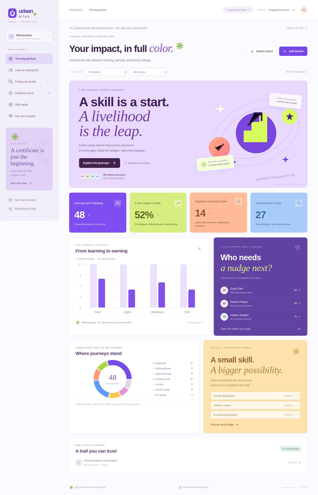

# Udaan Atlas ✳

### Every skill deserves a next chapter.

A colorful, working full-stack prototype for **Smart India Hackathon SIH26135**: tracking employment outcomes, skill gaps, and the impact of skilling initiatives.

**Repository:** https://github.com/Vthilakraj/udaan-atlas

## Complete project documentation

The 18-page report covers the problem, requirements, user journeys, architecture, data model, database, business rules, API, installation, testing, deployment, operations, and future work.

- [Download the PDF report](docs/Udaan_Atlas_Complete_Documentation.pdf)
- [Download the editable Word document](docs/Udaan_Atlas_Complete_Documentation.docx)
- [Read the documentation online](docs/Udaan_Atlas_Complete_Documentation.md)



[Phone layout](docs/images/overview-mobile.png)

The project has two deliberate modes:

| Mode                    | Purpose                                         | Data and access                                                                                             |
| ----------------------- | ----------------------------------------------- | ----------------------------------------------------------------------------------------------------------- |
| Public interactive demo | Explore the complete product on any static host | 48 fictional learners; changes saved in this browser; simulated role switching                              |
| Private backend         | Run an account-based programme workspace        | Node 24 + SQLite; authenticated programme-team, employer, and learner accounts; server-enforced permissions |

The public demo never claims to be connected to government employment records, a real vacancy feed, or a messaging provider. Do not enter real personal data in the public demo. This is an independent prototype, not an official government service.

## The distinct idea: a passport, a proof trail, and a practical next step

**Outcome Passport.** One chronological record connects training, learner updates, income, employer evidence, and support. A new outcome always needs its own evidence; an old employer confirmation cannot verify a new claim.

**Evidence with provenance.** Self-reported outcomes, programme-team reviews, employer confirmations, and mismatches remain visibly different. Private employer accounts can only review outcomes linked to their own organization. Learners cannot confirm their own employment.

**Explainable support priority.** A rules-based score shows why a learner might need a check-in: overdue milestones, missing or stale updates, leaving work, reported skills gaps, and evidence discrepancies. Gender, income, and district are not score inputs. Scores guide staff attention rather than deciding eligibility or taking adverse action.

**A skill-to-opportunity bridge.** Compare recorded learner skills against employer-entered role requirements. Show the exact missing skills and schedule a practical support check-in. Matching is an inspectable skills checklist, not an opaque hiring prediction.

**Consent that changes behavior.** Enrollment requires consent. Withdrawal removes the learner's name, email, skills, baseline income, outcome history, evidence, and follow-up tasks from the programme record. A minimal deidentified training tombstone and operational audit remain. Private login accounts are separate and should be removed by the operator according to its account-retention policy.

## What you can do

- Browse an impact dashboard with course comparisons, journey-stage charts, current work outcomes, employer-confirmed counts, and due follow-up milestones.
- Filter by district and course; inspect provider, training-cohort, and demographic summaries in the impact report.
- Enroll a learner, search and filter passports, record updates, and follow the person's timeline.
- Work through 30-, 90-, 180-, and 365-day milestones; schedule additional support.
- Copy a consent-led check-in draft or record an assisted conversation. **Copying does not send a message.**
- Review employment evidence and record an employer confirmation or discrepancy.
- Create employer organizations; post opportunities with pay ranges and skill requirements.
- Explore learner skills, matching opportunities, and practical skill gaps.
- Use the learner view to report an outcome and manage consent.
- Export an impact CSV or workspace JSON; validate and restore browser-demo backups.
- In private mode, sign in, provision role-bound accounts, persist data in SQLite, and handle concurrent updates safely.

## Start the public demo locally

Install **Node.js 24 or later**. Then:

```bash
git clone https://github.com/Vthilakraj/udaan-atlas.git
cd udaan-atlas
npm ci
npm run dev
```

Open the URL Vite prints, normally `http://localhost:5173`.

No API keys, paid services, or accounts are needed for this mode. Demo data lives under `udaan-atlas:v1` in local storage. A new browser, origin, or device has a different workspace. Clearing browser data removes changes; export a backup first. Use one editing tab for predictable results.

## Run the private full-stack version

```bash
cp .env.example .env
```

Edit `.env` locally:

- Set `ADMIN_EMAIL` to the initial administrator's email.
- Set `ADMIN_PASSWORD` to a unique password of at least 12 characters. The server rejects the example placeholder.
- For local development, use `PUBLIC_ORIGIN=http://localhost:5173` (no trailing slash).
- Set `SEED_SAMPLE_DATA=true` for a private demo, or `false` for an empty learner/employer workspace.
- Use a writable, persistent `DATABASE_PATH`.

```bash
npm run dev:full
```

Open the Vite URL and sign in with the configured administrator account. The API listens on port 4100; Vite proxies `/api` to it. Never commit `.env` or the database.

With `SEED_SAMPLE_DATA=false`, the app starts with no learners, employer organizations, or opportunities. The initial course/provider catalog in `shared/seed.ts` is illustrative: replace it with your authorized programme catalog before collecting real records. Add employer organizations in **Workspace & data**, then enroll learners and create bound accounts there.

An employer account must be bound to an existing employer ID; a learner account must be bound to a consenting learner ID. Give credentials to their owner securely. Admin credentials bootstrap only when the database has no admin; changing `.env` later does not change an existing password.

### Production server

```bash
npm ci
npm run build:api
npm start
```

Set `NODE_ENV=production`, `PUBLIC_ORIGIN=https://your-domain.example` (no trailing slash), the database path, and the bootstrap admin variables in your host's protected environment settings. Put the server behind HTTPS. A production server refuses an HTTP public origin. The origin must match the website the user actually opens. Serve the frontend and API on the same origin; CORS is intentionally not enabled.

`npm run build` creates the browser demo. **Use `npm run build:api` for a backend-connected deployment.** Static hosting cannot run the private backend.

### Container deployment

The included multi-stage `Dockerfile` builds API mode and runs as a non-root user. Provide runtime environment variables with your host's secret manager or a private env file. Mount a persistent volume at `/app/data`. Do not bake credentials or personal records into an image. The image uses port 4100 and still requires an HTTPS `PUBLIC_ORIGIN` for production.

## Publish the browser demo

### GitHub Pages

1. In the repository, open **Settings → Pages → Build and deployment → Source → GitHub Actions**.
2. Open **Actions → Publish Udaan Atlas → Run workflow**, select `main`, and run it.
3. Wait for both jobs to succeed. GitHub shows the published URL on the deployment.

For this repository, the address after successful deployment is `https://vthilakraj.github.io/udaan-atlas/`. Run the publication workflow again when you want to publish an update. The CI workflow checks every push separately.

Asset paths are relative, so repository subpaths work without editing the Vite base URL. Internal views do not require SPA rewrite rules.

### Vercel or Netlify

Import the repository with the Vite preset, use `npm run build`, Node 24, and the `dist` output directory. Both host configuration files are included. These publish the **browser demo**, not the private API. No environment secrets are needed for the demo.

## Verify

```bash
npm test          # Domain invariants + authenticated API integration tests
npm run build    # TypeScript + browser-demo production build
npm run build:api # TypeScript + backend-connected frontend build
npm run test:ui   # Chromium workflows, desktop/phone checks, and screenshots
```

The browser suite uses an installed Chromium at `/usr/bin/chromium` by default. Set `CHROMIUM_PATH` to another compatible Chrome/Chromium executable if needed. It starts and stops its own Vite server on port 5178. For a machine without a browser, install Chromium using the operating system's normal package manager, then set that path. Screenshots and failure details go into the ignored `test-results` directory.

The CI workflow uses Node 24 and the Chrome installed on its Ubuntu runner. It runs domain/API tests, both builds, and the browser workflows.

## Metrics that say what they mean

- **Currently in work:** latest outcome is employment, self-employment, or apprenticeship, divided by consenting learners in the chosen view. Missing outcomes remain a separate group.
- **Employer-confirmed:** the exact latest work outcome has a latest confirmation from its linked employer account. Programme-team reviews do not count as independent employer evidence.
- **Recent outcome coverage:** the latest outcome is no more than 90 days old.
- **Median income gain:** the median of current positive monthly income minus a known pre-training baseline, among learners currently in work. Baseline zero is valid; unknown baseline is excluded. This is a descriptive change, not proof of programme causation.
- **90-day work continuity:** among learners with a recorded work outcome at least 90 days ago, how many are in work in their latest update. This does not establish uninterrupted employment or retention with the same employer. The eligible denominator is displayed.
- **Due conversations:** overdue/current incomplete follow-up milestones, not distinct learners. One person can have more than one missed milestone.

See [the SIH design note](docs/SIH26135.md) for requirement mapping, a demonstration script, and extension points.

## Architecture

```text
React + TypeScript interface
  ├── Browser demo adapter → validated local-storage workspace
  └── Same-origin API adapter → Express → SQLite
                                  ├── users (salted password hashes)
                                  ├── sessions (hashed session tokens + expiry)
                                  └── workspace (revisioned domain state)

shared/model.ts → validation, permissions, state transitions, metrics
shared/seed.ts  → reproducible fictional cohort and editable starter catalog
```

The private server uses HttpOnly/SameSite session cookies, production Secure cookies, origin checks for writes, login rate limiting, scoped reads, action-level permissions, transaction-backed persistence, and optimistic revision checks. Client-supplied roles are never trusted. Passwords are hashed with scrypt; plaintext passwords and session tokens are not stored in the database. SQLite files and backups still need host-level protection.

## Practical limits and next steps

This is a working hackathon prototype, not a certified production government system. The JSON workspace row keeps the domain easy to inspect; a large deployment should migrate to normalized tables, bounded queries, and a durable job queue. Add password recovery, account deletion, administrator password rotation, stronger audit retention controls, institutional employer onboarding, observability, disaster recovery, and a formal privacy/data-retention process before operational use.

An employer account's confirmation is evidence from that account, not an independently validated institutional identity. Do not represent it as an official employment-database check. No payroll, EPFO, Aadhaar, messaging, or government API is connected. External integrations require authorized access, consent-aware delivery, delivery receipts, and provider setup; copying a message draft is the current low-burden assisted workflow.

The browser demo has no authentication and its role switch is illustrative. Never use it to protect real records. Demo backup restore replaces the workspace after validation; backend restore requires an operator-managed database backup. Income and location are sensitive; avoid public individual-level exports. Google Fonts supplies the interface fonts, with local fallbacks; icons and original SVG illustrations are bundled. There are no analytics or tracking SDKs.

## License

MIT. Original interface, illustration, domain logic, server, and documentation are included. Dependencies retain their own licenses.
